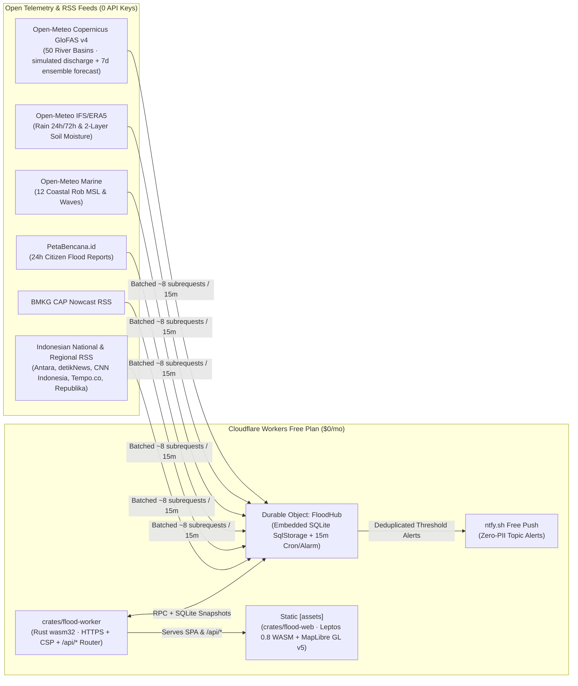
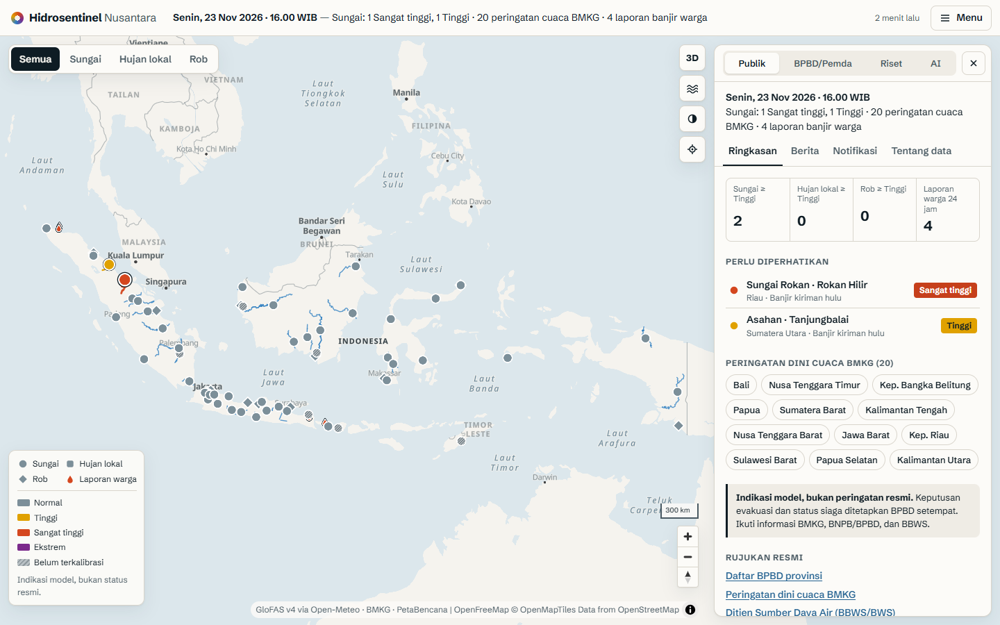

# Hidrosentinel Nusantara — Indonesia Flood & River Discharge Observatory (`flood.transbulent.id`)

**100% Rust Full-Stack (`Leptos` CSR WebAssembly + `workers-rs` + Cloudflare SQLite Durable Objects + MapLibre GL v5 3D)**

Observatorium banjir dan hidrometeorologi seluruh Indonesia yang memisahkan tiga mekanisme banjir — **sungai (kiriman hulu DAS)**, **hujan lokal (drainase kota)**, dan **rob pesisir** — dengan hidrograf ensemble, berita banjir regional RSS, peringatan dini BMKG Nowcast, kanal notifikasi gratis (`ntfy.sh` + WhatsApp Share + RSS), serta API ramah *AI Agent* (`/llms.txt` & `/api/openapi.json`).

> **Indikasi model, bukan peringatan resmi.** Peringatan dini resmi berasal dari BNPB/BPBD, BMKG, dan Balai (Besar) Wilayah Sungai. Situs ini tidak memakai status Waspada/Siaga/Awas. Metodologi lengkap: [`docs/METODOLOGI.md`](docs/METODOLOGI.md); kontrak API: [`docs/API.md`](docs/API.md).

---

## Architecture / Arsitektur



---

## Preview (Desktop & Mobile)

> Live URL: **[https://flood.transbulent.id/](https://flood.transbulent.id/)**

*(Tangkapan layar build v2, 22 Nov 2026)*

| Desktop (`1440×900`) | Mobile (`390×844`) |
|---|---|
|  |  |

---

## Ringkasan Bahasa Indonesia

**Hidrosentinel Nusantara** dibangun seluruhnya dalam bahasa **Rust** dari *backend* Cloudflare Worker hingga antarmuka *frontend* WebAssembly (hanya menjembatani kanvas WebGL **MapLibre GL v5** melalui modul ES tipis).

### Keunggulan Utama
1. **Pemisahan 3 Mekanisme Banjir dengan Level Indikasi Terkalibrasi**
   * **Sungai**: debit harian simulasi **Copernicus GloFAS v4** pada sel yang dikalibrasi terhadap pos (44/50 diterima; 6 sel ditolak tampil "Belum terkalibrasi"). Level *Tinggi / Sangat tinggi / Ekstrem* = melampaui **Q2 / Q5 / Q20** (Gumbel, L-moment, maksimum tahunan reanalisis **1997–2024**), plus peluang lampau ambang dari 51 anggota ensemble 7 hari.
   * **Hujan lokal (drainase)**: hujan model 24 jam terakhir/ke depan terhadap kategori BMKG (lebat ≥ 50 mm, sangat lebat ≥ 100 mm, ekstrem > 150 mm), lengas tanah 2 lapis, dan laporan warga **PetaBencana.id** ≤ 10 km.
   * **Rob pesisir**: puncak muka laut model 48 jam (Open-Meteo Marine) terhadap persentil klimatologi setempat di **12 koridor pesisir** (Jakarta Utara, Muara Gembong, Pekalongan, Semarang–Sayung, Belawan, Pontianak, Banjarmasin, Makassar, Merauke, dll.).
   * **Sungai riil berkelok**: garis sungai diambil dari geometri OpenStreetMap (dua tingkat detail, arah ke hilir), bukan garis lurus antartitik. Tautan "Bandingkan di Google Flood Hub" di setiap detail stasiun.
   * **Riwayat genangan Google (opsional, mati secara bawaan)**: tombol gelombang di peta menyalakan *Inundation History 1999–2020* (frekuensi piksel 128 m tampak basah pada citra satelit; tiga kelas ≥ 0,5% / ≥ 1% / ≥ 5% waktu), dimuat lazy per ubin. Setiap stasiun dan titik rob juga menampilkan luas genangan historis dalam radius 5 km, dengan catatan bahwa ini bukan peta rawan banjir resmi.
   * **Uji silang GRRR (lensa Riset)**: ambang Q2 GloFAS dibandingkan dengan *Google Runoff Reanalysis & Reforecast* 1980–2023 di sekitar pos. Hasilnya model-terhadap-model dan menandai stasiun yang perlu diverifikasi dengan pos duga air; tidak memengaruhi level.
   * **Validasi pos duga air (lensa Riset)**: rerata debit sel GloFAS dibandingkan dengan rerata terukur pos GRDC di sungai yang sama (5 stasiun: Bengawan Solo Bojonegoro dan Sragen, Brantas, Walanae, Tondano). Menguji apakah sel mewakili sungai yang benar, bukan ambang banjir.
   * **Uji pendahuluan Q2 terukur**: maksimum tahunan debit harian GSIM/GRDC untuk Jurug, Sempajeruk, dan Kairagi, serta nilai terbit untuk Bojonegoro (lebih lemah, ditandai), dibanding ambang GloFAS; mutu rekaman dan sensitivitas ditampilkan di Riset. Jabon belum dapat dinilai. Belum validasi operasional; tidak mengubah level.
2. **All-Rust + SQLite Durable Object (`FloodHub`)**
   * Data disimpan di **Cloudflare Durable Object SQLite** (`new_sqlite_classes = ["FloodHub"]`) — aktif otomatis di paket gratis Cloudflare Workers tanpa server terpisah.
   * Berbagi tipe data & logika hidrologi antara server dan klien lewat crate `flood-shared`.
3. **Multi-Perspektif + Mobile-First + Berita & Peringatan Gratis**
   * Switcher perspektif (**Publik**, **BPBD/Pemda**, **Akademisi/Riset**, **AI Agent**).
   * **Kanal Berita Banjir**: agregasi otomatis berita banjir nasional/regional + peringatan dini cuaca ekstrem **BMKG Nowcast CAP**.
   * **Peringatan Gratis Tanpa Biaya SMS/WA Gateway**: langganan notifikasi push HP gratis via **`ntfy.sh`** (tanpa menyimpan nomor HP/PII), tombol **Bagikan WhatsApp 1-Klik**, dan **RSS Feed Wilayah (`/api/alerts.rss`)** siap sambung ke bot Telegram/n8n.
4. **Mode Replay Historis (Terpisah Jelas dari Data Live)**
   * Putar ulang skenario **Jabodetabek 1 Jan 2020**, **DAS Barito Kalsel Jan 2021**, dan **Tanggul Wulan–Demak 2024** (GloFAS v4 reanalisis + ERA5) dengan label `DATA REPLAY HISTORIS`, beserta render relief 3D (forge3D, DEM Google GEM-15 15 m dan Terrain Tiles).
5. **AI-Driven & Ramah Agen Eksternal**
   * Kolom **AI Tanya Data** di aplikasi (`GET /api/ai/query?q=...`) mengarahkan kamera peta & filter secara otomatis.
   * Mendukung discovery agen eksternal lewat **`/llms.txt`**, **`/api/openapi.json`**, dan **`/api/ai/briefing`**; lensa Riset menyediakan unduhan GeoJSON, tautan **GeoLibre**, dan DTM **GEM-15** per stasiun.

---

## AI-Driven & Machine-Readable Endpoints

| Endpoint | Purpose |
|---|---|
| `GET /llms.txt` | Concise LLM discovery manifest with hydrological caveats |
| `GET /api/openapi.json` | OpenAPI 3.1 schema for AI agents & tool integrations |
| `GET /api/flood` | Full snapshot: 50 river stations, 12 coastal Rob corridors, PetaBencana reports, BMKG nowcasts, news |
| `GET /api/stations.geojson` | Stations with current indication levels as GeoJSON |
| `GET /api/station/{id}` | Simulated (not gauged) GloFAS hydrograph + 7-day forecast & soil telemetry |
| `GET /api/ai/briefing?region=&audience=public\|gov\|academia\|ai_agent&format=json\|md` | Deterministic multi-audience SitRep briefing |
| `GET /api/ai/query?q=...` | Natural-language Indonesian/English river & alert search with map `fly_to` coordinates |
| `GET /api/alerts.rss?region=...` | Regional/national RSS 2.0 warning feed |
| `POST /api/alerts/subscribe` | Register a zero-PII `ntfy.sh` push notification topic |
| `GET /api/health` | SQLite Durable Object freshness & upstream health |

---

## Local Development & Deployment

### Prerequisites
* Rust toolchain (`rustc` + `cargo`) with `wasm32-unknown-unknown` target:
  ```bash
  rustup target add wasm32-unknown-unknown
  cargo install trunk --locked
  cargo install worker-build --locked
  ```
* Wrangler CLI (`npx wrangler` or global `wrangler`)

### Test & Check
```bash
cargo test -p flood-shared
cargo check -p flood-worker --target wasm32-unknown-unknown
cargo check -p flood-web --target wasm32-unknown-unknown
```

### Build & Deploy to Cloudflare Workers
1. Copy `crates/flood-worker/wrangler.toml.example` to `crates/flood-worker/wrangler.toml` (gitignored) and fill your Cloudflare `account_id` and domain routes.
2. Build the Leptos WASM frontend:
   ```bash
   cd crates/flood-web
   trunk build --release
   ```
3. Build and deploy the Rust Worker + SQLite Durable Object + static `[assets]`:
   ```bash
   cd ../flood-worker
   npx wrangler deploy
   ```

See [`ARCHITECTURE.md`](ARCHITECTURE.md) for the horizontal Durable Object sharding and WebSocket Hibernation scale-up roadmap.

---

## License & Attribution

* Code: **MIT License** ([`LICENSE`](LICENSE)).
* Open datasets & bundled assets: see [`THIRD_PARTY_NOTICES.md`](THIRD_PARTY_NOTICES.md) and [`CITATION.cff`](CITATION.cff).
